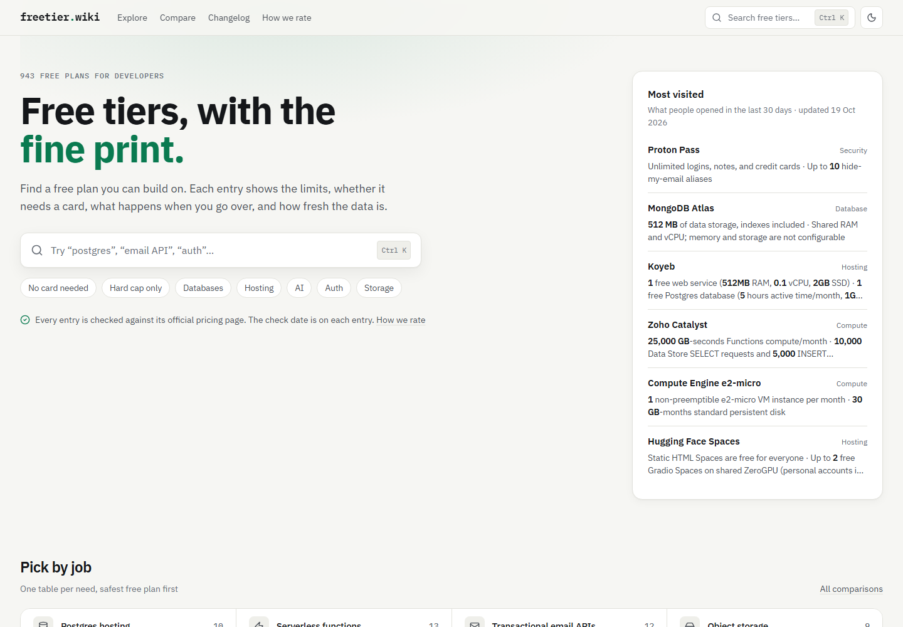

# FreeTierWiki

**Compare free developer tools with their limits and billing risks in view.**

[FreeTierWiki](https://freetier.wiki) is a catalog of 900+ services and tools with free plans, credits, or trials. Find out what each offer includes, what happens at the limit, and when its details were last checked.

[Browse the catalog](https://freetier.wiki/explorer/) · [Compare options](https://freetier.wiki/compare/) · [See recent changes](https://freetier.wiki/changelog/) · [Contribute](CONTRIBUTING.md)

[](https://freetier.wiki)

## Find an offer that fits

- **Search and filter** by category, service or tool, and billing risk. Explorer links preserve your filters.
- **Compare options for one job**, such as hosting Postgres or tracking application errors.
- **Read the actual constraints:** usage allowances, card requirements, renewal rules, and behavior at the limit.
- **Check the sources and dates.** Each entry links to the provider and shows how fresh its information is.
- **Follow changes** to plans through the [changelog](https://freetier.wiki/changelog/) or [RSS feed](https://freetier.wiki/changelog/feed.xml).

## Understand the labels

Free plans, credits, and trials have different tradeoffs. Each entry labels its plan type and billing risk:

| Billing risk | What it means |
| --- | --- |
| **None** | Usage stops or throttles at the limit, or the service is unlimited. |
| **Low** | Unexpected charges are unlikely; read the entry's caveats. |
| **Medium** | Usage above the free allowance can be billed to a card on file. |
| **High** | Usage is billed from the start, or there is no current free offer. |

A **checked date** records a comparison with official sources, or a later automated check confirming that the tracked pricing text is unchanged since review. Entries become stale after 180 days. An **imported date** means the entry has not been re-checked; use it as a starting point for research. Changed and ended offers are marked separately.

[Read the full label guide →](https://freetier.wiki/about/)

## How the catalog stays current

Pricing changes are part of the project's ongoing maintenance:

1. A weekly workflow fetches official pricing pages and compares their pricing text with the previous scan.
2. Changed pages are flagged in a GitHub issue for review. A text change is a reason to investigate; it does not establish that a plan changed.
3. Reviews compare entries with provider pricing pages and documentation, then propose corrections through pull requests.
4. Reviewed changes update the entry's sources, verification date, and changelog where appropriate. Unresolved claims keep their previous verification dates.

Unchanged pricing text can advance an already-reviewed entry's checked date. Blocked or unreadable pages cannot confirm an entry. The [maintenance guide](docs/content-maintenance.md) explains the workflow and its limitations; [review notes](docs/reviews/) record previous investigations.

## Help improve an entry

Use **Report outdated info** on an entry, or [open an issue](https://github.com/0langa/FreeTierWiki/issues/new?template=outdated-info.yml) with the official source and the detail that needs correcting. New listings and corrections are welcome. See [CONTRIBUTING.md](CONTRIBUTING.md) for the content requirements.

## Run locally

Use Node.js 22, as pinned in [.nvmrc](.nvmrc):

```sh
npm ci
npm run dev
```

Built with Next.js, TypeScript, Tailwind CSS, and MDX. The site is exported as static files and hosted on Cloudflare Pages.

| Documentation | Details |
| --- | --- |
| [Development](docs/development.md) | Setup, checks, architecture, and deployment |
| [Content maintenance](docs/content-maintenance.md) | Entry fields, evidence tools, and the weekly pricing check |
| [Site guide](docs/site-guide.md) | Browsing, comparisons, detail pages, and labels |
| [Contributing](CONTRIBUTING.md) | Reporting errors and submitting listings |

## License

[MIT](LICENSE). The bundled IBM Plex fonts retain their [SIL Open Font License](src/fonts/LICENSE-ibm-plex.txt).

Always confirm current pricing and terms on the provider's official website before choosing a service.
